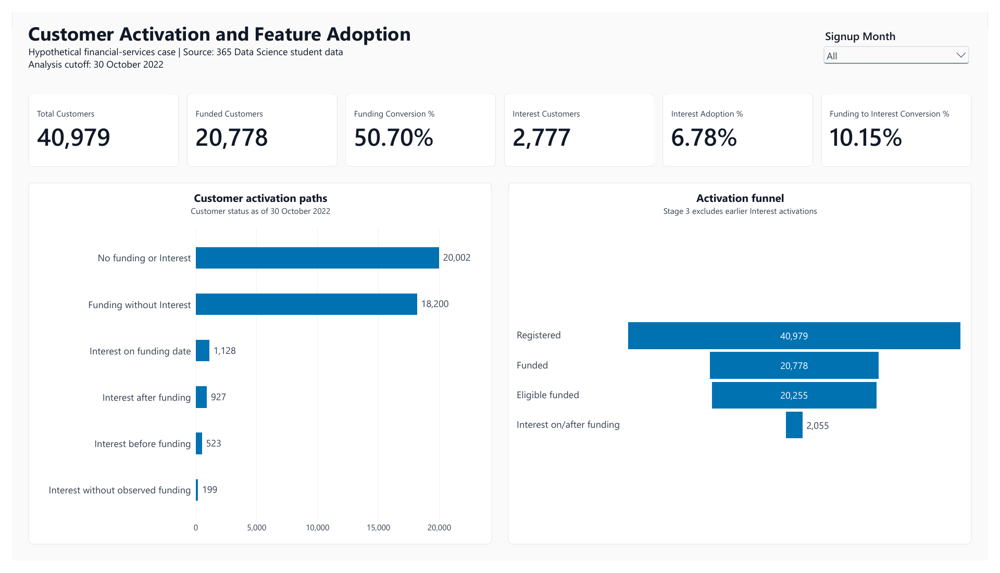

# Customer Activation and Feature Adoption

**MySQL · Power BI · DAX**

A portfolio project examining activation paths, conversion windows, signup cohorts, waiting-time distributions and repeat activity. This repository exposes the analytical code and reporting decisions behind the finished report.

**Data context:** the observations describe students, lecture activity and purchases from a 365 Data Science exercise. Account creation, funding activity and Interest adoption are fictional interpretations. These are not actual financial-customer observations or evidence about any named company.

[View the case study](https://alex-karam.github.io/projects/customer-activation/index.html) · [Report PDF](reports/customer-activation-report.pdf) · [SQL](sql/customer_activation.sql) · [DAX](power-bi/MODEL_MEASURES.dax)

## What can be inspected here?

| Evidence | Where to look |
|---|---|
| Complete ordered SQL workflow: source checks, reporting views and analysis | [SQL script](sql/customer_activation.sql) and [step guide](docs/sql-guide.md) |
| Five helper tables and 26 DAX measures | [Model and delay/repeat definitions](power-bi/MODEL_MEASURES.dax), [six window measures](power-bi/WINDOW_MEASURES.dax) |
| Model relationship, disconnected helpers and visual configuration | [Power BI model](docs/power-bi-model.md) |
| Source fields, view lineage and the 13-column customer summary | [Data dictionary](docs/data-dictionary.md) |
| Numerators, denominators, cutoff and interpretation choices | [Methodology](docs/methodology.md) |
| Expected results and checks performed | [Validation record](docs/validation.md) |
| Prerequisites and rebuild instructions | [Reproduction guide](docs/reproduce.md) |

For a quick technical review, start with SQL Steps **14, 19, 23, 28 and 30**, then inspect **Eligible Funded Customers**, **Funding to Interest Conversion % (Window)** and **P90 Delay (Days)** in the DAX files.

## Questions and findings

1. **Where does progression stop?** By 30 October 2022, 20,778 of 40,979 registrations have observed funding (**50.70%**). Six mutually exclusive paths distinguish missing events, same-date adoption and Interest before funding.
2. **How quickly do customers convert?** With full 30-day follow-up, funding conversion is **17,517 / 36,944 = 47.42%**; sequential Interest conversion is **1,768 / 17,579 = 10.06%**. These have different anchors and eligible populations.
3. **Are newer cohorts improving?** Results vary: 30-day funding conversion is 52.17% in January, 43.12% in June and 53.95% in September 2022. October has no eligible 30-day observations, so its rate is unavailable.
4. **What do distributions reveal?** Both medians are **0 days**, versus means of **3.90** and **8.23** days. P90 is **3** and **18** days; maxima are **313** and **302**. Long tails were retained.
5. **Do funded customers return?** Later-day activity within 7 and 30 days is **29.44%** and **34.66%**, among customers with the respective full follow-up. This is repeat activity, not balance retention or churn.

Overall Interest adoption is **2,777 / 40,979 = 6.78%**. Snapshot sequential conversion is **2,055 / 20,255 = 10.15%**, excluding 523 customers whose first Interest event preceded funding. It is distinct from both overall adoption and fixed-window conversion.

## Implementation decisions

- Aggregate each event stream before joining, preserving one row per registration and customers with no later events.
- Apply one exercise cutoff across event streams, rather than using the longer purchase history only for one stage.
- Require full follow-up from the relevant anchor for each conversion window. Include elapsed days 0–N for conversion and 1–N for repeat activity.
- Preserve NULL/BLANK for absent or excluded outcomes. Keep legitimate zero-day observations; leave rates with zero denominators undefined.
- Compute cohort totals from summed eligible/converted counts, rather than averaging percentages.

## Report and validation

The three pages cover [activation](reports/images/activation-overview.png), [conversion and cohorts](reports/images/conversion-and-cohorts.png), and [delays and repeat activity](reports/images/delays-and-repeat-activity.png).

SQL and report controls were reconciled for the full population. Signup-cohort and empty-sample interactions were checked in Power BI, refresh was demonstrated on the existing local MySQL setup, and every exported PDF page was rendered and visually reviewed. The final summary has **40,979 rows and distinct customer IDs**, with zero invalid repeat dates or dates beyond the cutoff. See the [validation record](docs/validation.md) for scope and controls.

## Reproduction and scope

The repository includes code, documentation and aggregate report exports. **Course data and the PBIX are not redistributed**; source-data redistribution permission has not been established. Full execution requires an authorised local copy of the original exercise tables. Code review does not require those data.

The DAX files document individual definitions from the project workflow; they are not batch scripts or direct exports of the PBIX model. The working report was validated locally; a fresh-machine rebuild has not been tested. See [reproduction instructions](docs/reproduce.md).

The financial meanings, universal feature eligibility and tracking completeness through the cutoff are assumptions. There are no amounts, balances, currencies, acquisition channels or intervention/exposure fields. Date-only observations cannot establish intraday ordering. Delay statistics describe observed converters, and cohort differences do not establish causation.

## Contribution and attribution

This was an **AI-assisted portfolio project**. I ran the SQL in MySQL Workbench, built and configured the Power BI report, checked results against control totals, tested filters and refresh, and reviewed the report outputs. SQL, DAX and documentation were developed with assistance. The source exercise is credited to **365 Data Science**; no affiliation or commercial financial-services experience is implied. See [attribution](ATTRIBUTION.md).
