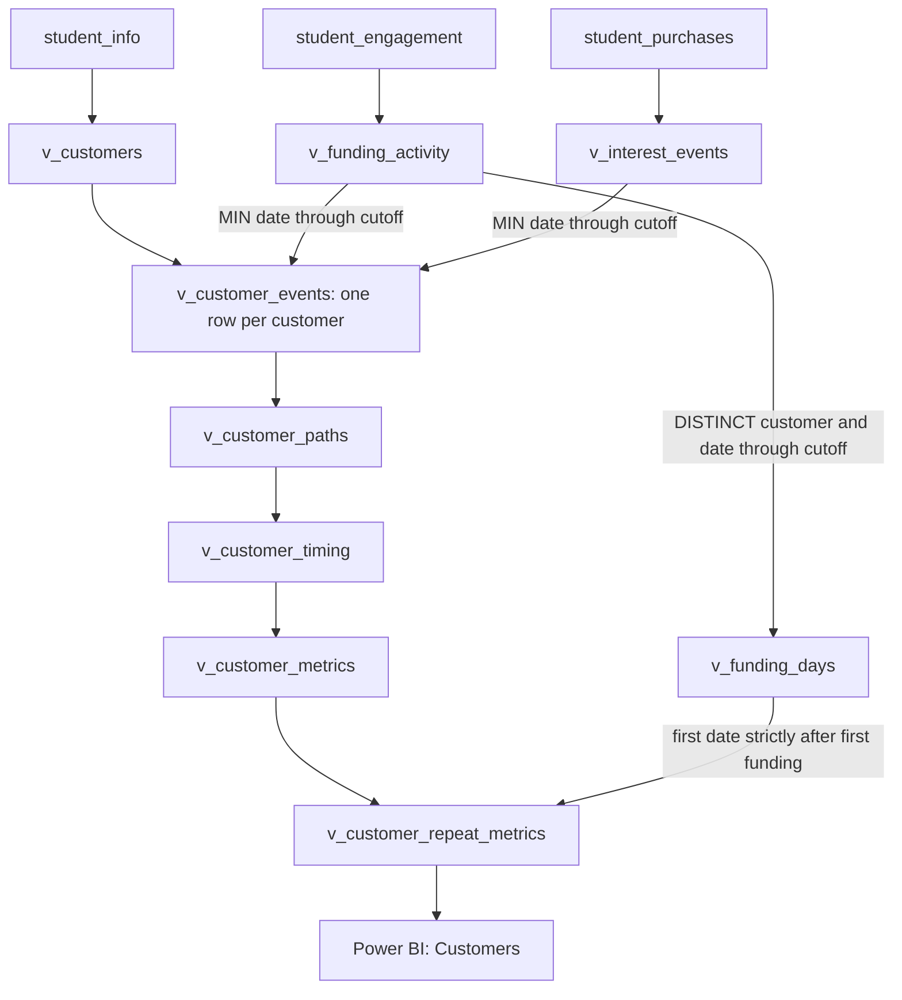

# Data dictionary and SQL view lineage

[Overview](../README.md) · [Methodology](methodology.md) · [Power BI model](power-bi-model.md)

No row-level observations are included. Types and controls below describe the exercise source used locally.

## Source tables: db_course_conversions

| Table | Field | Source type | Schema permits NULL | Role |
|---|---|---|---|---|
| student_info | student_id | INT | No | Primary key; fictional customer identifier |
| student_info | date_registered | DATE | Yes | Fictional account-creation date |
| student_engagement | student_id | INT | Yes | Student identifier matched to registrations |
| student_engagement | date_watched | DATE | Yes | Fictional funding activity date |
| student_purchases | purchase_id | INT | No | Primary key; fictional Interest event identifier |
| student_purchases | student_id | INT | Yes | Student identifier matched to registrations |
| student_purchases | date_purchased | DATE | Yes | Fictional Interest activation date |

The event identifiers are logically matched to registrations; the course schema inspection did not show those student_id columns as declared foreign keys. Source counts are 40,979 registrations, 74,246 engagement rows and 5,922 purchase rows. Schema nullability is distinct from observed missing values; the checks found no missing event/student IDs or dates in the relevant observations.

There are 18 repeated purchase student/date groups with 18 additional rows. These are not assumed to be erroneous duplicates; separate purchase IDs may represent distinct events. Earliest-event summaries count customers once, and repeat funding uses distinct activity days. No source rows are deleted.

## Reporting schema: customer_activation_case

| View | Added meaning | SQL step |
|---|---|---:|
| v_customers | Aliases registrations as customer accounts | 11 |
| v_funding_activity | Aliases lecture observations as funding activity | 12 |
| v_interest_events | Aliases purchases as Interest events | 13 |
| v_customer_events | First event dates and common cutoff; one row per registration | 14 |
| v_customer_paths | Six activation paths | 16 |
| v_customer_timing | Signup month and elapsed delays | 17 |
| v_customer_metrics | Available follow-up from signup and funding | 18 |
| v_funding_days | Distinct activity dates through cutoff | 26 |
| v_customer_repeat_metrics | First later activity date and elapsed repeat delay | 27 |

## Final view: 13 columns, one row per registration

Power BI imports **v_customer_repeat_metrics** and names the query **Customers**.

| Column | Power BI type | Meaning / missing-value rule |
|---|---|---|
| customer_id | Whole number | Unique registration identifier; do not SUM it |
| account_created_date | Date | Registration date through cutoff |
| analysis_cutoff_date | Date | Fixed exercise date 2022-10-30 |
| first_funding_date | Date | Minimum funding activity through cutoff; NULL if absent |
| first_interest_date | Date | Minimum Interest event through cutoff; NULL if absent |
| activation_path | Text | One of the six path labels below |
| signup_cohort_month | Date | First calendar day of account-creation month |
| days_to_first_funding | Whole number | First funding minus signup; NULL if no funding; zero is valid |
| days_funding_to_interest | Whole number | First Interest minus first funding only when Interest is on/after funding; otherwise NULL |
| signup_followup_days | Whole number | Cutoff minus signup |
| funding_followup_days | Whole number | Cutoff minus first funding; NULL if no funding |
| first_repeat_funding_date | Date | Minimum distinct funding date strictly after first funding; NULL if absent |
| days_to_repeat_funding | Whole number | First repeat minus first funding; NULL if absent |

Keep missing dates and delays as NULL/BLANK; do not replace them with zero. Days are elapsed calendar-day differences, not timedeltas with hour-level precision.

| activation_path value | Full-population customers |
|---|---:|
| No funding or Interest | 20,002 |
| Funding without Interest | 18,200 |
| Interest on funding date | 1,128 |
| Interest after funding | 927 |
| Interest before funding | 523 |
| Interest without observed funding | 199 |
| **Total** | **40,979** |
