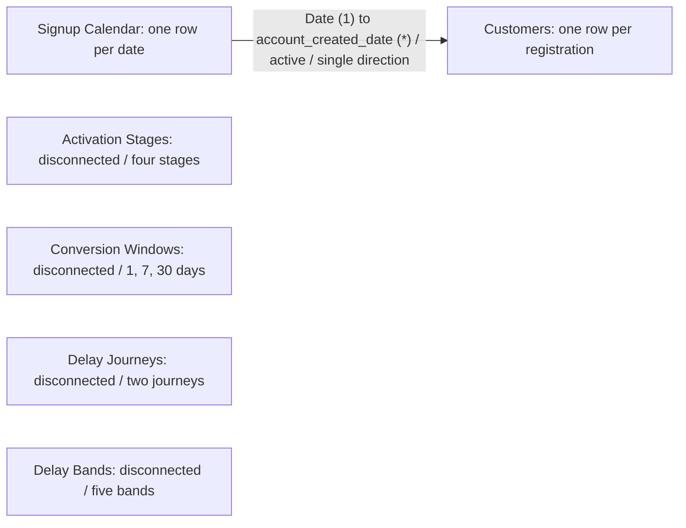

# Power BI model and report configuration

[Overview](../README.md) · [Model/helper DAX](../power-bi/MODEL_MEASURES.dax) · [Window measures](../power-bi/WINDOW_MEASURES.dax)

## Documented model

Only the calendar relationship is present in this documented setup. The other four helper tables select calculation/visual categories via SELECTEDVALUE, SWITCH and FILTER; they do not filter customer records through relationships. This is a documentation diagram based on the project setup, not a Power BI Model view screenshot or a direct model export.

| Table | Grain / configuration |
|---|---|
| Customers | Imported MySQL view; 40,979 rows, 13 fields |
| Signup Calendar | Daily calendar covering complete years 2021–2022, 730 rows; Date and Signup Month (yyyy-MM) |
| Activation Stages | Four ordered funnel labels; sort Stage by Stage Order |
| Conversion Windows | Integer Window Days: 1, 7, 30; Don't summarize in tables |
| Delay Journeys | Signup to funding / Funding to Interest; journey-selecting measures |
| Delay Bands | 0, 1–7, 8–30, 31–90 and 91+; sort Delay Band by Band Order; upper bound is blank for 91+ |

Relate **Signup Calendar[Date] (1)** to **Customers[account_created_date] (*)**, active, with single-direction filtering from the calendar. Cohort selections mean signup dates, not funding/activity dates. Use a Date type for the calendar's Date column. Date-table marking was specified during the report build; its settings dialog was not separately captured in the review evidence.

## Definition inventory

The two DAX files contain **five calculated helper-table definitions and 26 measure definitions**, to create separately. Names of all **24 distinct measures directly referenced by saved report visuals** are covered. The two remaining measures, Eligible Funded Customers and Sequential Interest Customers, support dependent rates/funnel calculations.

| Home table | Definitions |
|---|---|
| Customers | Eight snapshot measures in MODEL_MEASURES; six conversion-window measures in WINDOW_MEASURES; three repeat-window measures in MODEL_MEASURES |
| Activation Stages | Funnel Customers |
| Delay Journeys | Observed Converters, Mean Delay, Median Delay, P90 Delay, Maximum Delay, Same-Day Share |
| Delay Bands | Converters in Band, Delay Band Share |

The DAX files are readable documentation of the measure definitions, not scripts to paste into DAX Query View as a batch. They were not extracted directly from the PBIX data model. Do not read the metadata coverage check as a fresh execution test of those transcriptions.

## Three report pages

### 1. Activation overview

- Six cards: Total Customers; Funded Customers; Funding Conversion %; Interest Customers; Interest Adoption %; Funding to Interest Conversion %.
- Path bar chart: activation_path as categories, Total Customers as values.
- Funnel: Activation Stages[Stage] as category, Funnel Customers as values. Sort by Stage Order. Eligible funded is explicitly an eligibility adjustment.
- Signup Month dropdown from Signup Calendar. Visual filter Total Customers > 0 shows the 11 observed months. Default is All.
- Hide registration-based funnel conversion markers to avoid confusing them with the eligible-funded conversion KPI.

### 2. Conversion and cohorts

- Two summary tables: Window Days plus each journey's eligible, converted and rate measures. Keep all windows 1, 7, 30.
- Two matrices: Signup Calendar[Signup Month] as rows, Conversion Windows[Window Days] as columns, eligible/converted/rate measures as values.
- Apply **Window Days = 30 only to each cohort matrix**. Use Total Customers > 0 there to keep the observed signup months. October stays visible with 0 eligible/converted and a blank rate.
- Cohort totals recompute rates from counts. Suppress totals across different windows.

### 3. Delays and repeat activity

- Statistics table: Delay Journeys[Journey], converter count, mean, median, P90, maximum and same-day share.
- Clustered column chart: Delay Band as X, Delay Band Share % as Y, Journey as legend; Converters in Band in tooltips.
- Band matrix: Delay Band as rows, Journey as columns, Converters in Band as values.
- Repeat table: Window Days filtered to 7 and 30, with eligible, returned and repeat-rate measures. All funded Interest paths remain eligible.
- Signup Month is available as a page-filter card; no visible or synchronised cohort slicer was configured on this page. Default page filters are All.

## Formatting

Use the included [theme](../power-bi/Customer_Activation_Theme.json), blue/orange series, direct printed values and text categories. Colour is not the sole encoding. Report canvases are 1920 × 1080, with consistent headers, source disclosure and cutoff on every page.

Counts are grouped integers; rates and mean/median use two decimals; P90/max are integer days. Distribution labels alone use one decimal for space, with exact counts alongside. Do not replace undefined rates with zero or average cohort rates/medians.

The [three-page PDF](../reports/customer-activation-report.pdf) is the reviewed presentation artifact. Its page images show report output, not the live authoring interface.
